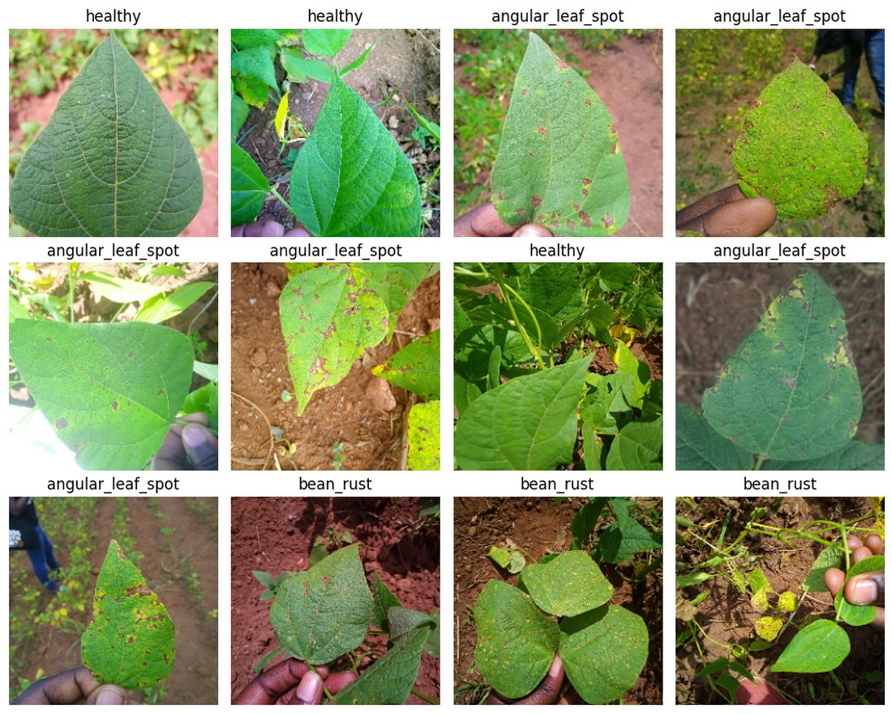
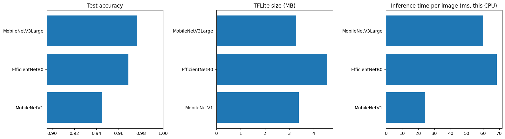
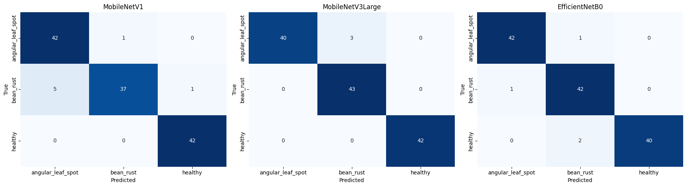
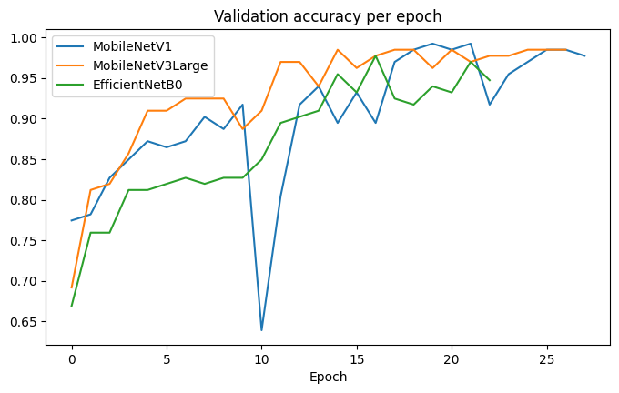

# Phase 1: Bean Leaf Disease Classification — MobileNet Transfer Learning

Image classifier that detects two common bean leaf diseases, **angular leaf spot** and **bean rust**, and recognises **healthy** leaves from a photo. It compares three mobile-friendly CNN backbones and exports the best one to **TensorFlow Lite** for an offline Android app.

**Best model: MobileNetV3-Large, 97.7% test accuracy (125/128), 3.3 MB on-device model**

➡️ **Phase 2: deployment** (offline Android app, parity tests, signed APK and download site): **[Bean-Disease-Classification-Android-Deployment](https://github.com/majeedar/Bean-Disease-Classification-Android-Deployment)**

<p align="center">
  
</p>

---

## Why this project

Angular leaf spot and bean rust are among the most damaging diseases of common beans, a staple crop for millions of smallholder farmers. Early detection lets farmers remove infected material and act before a disease spreads. Expert diagnosis is often not available in the field, but a phone camera usually is.

The goal: a model **small and fast enough to run offline on a low-end Android phone**, while staying highly accurate.

---

## Results

All three models were trained on the same data split with the same two-stage recipe and evaluated on the same held-out test set (128 images).

| Model | Test accuracy | Macro F1 | Errors (of 128) | TFLite accuracy | TFLite size |
|---|---|---|---|---|---|
| **MobileNetV3-Large** ✅ | **97.7%** | **0.977** | **3** | **97.7%** | **3.3 MB** |
| EfficientNetB0 | 96.9% | 0.969 | 4 | 93.8% | 4.6 MB |
| MobileNet V1 | 94.5% | 0.945 | 7 | 94.5% | 3.4 MB |

**Why MobileNetV3-Large was chosen**
- Highest accuracy and fewest errors
- **No accuracy loss after TFLite conversion and quantization.** EfficientNetB0 lost about 3 points in its TFLite version, which is the version that would actually run on the phone.
- Smallest on-device file

<p align="center">
  
</p>

<p align="center">
  
</p>

MobileNetV3-Large's only mistakes were 3 angular leaf spot images classified as bean rust. It identified every healthy leaf correctly.

> **Note on the numbers:** with 128 test images, one image is about 0.8 percentage points. The ranking is consistent across accuracy, F1 and validation curves, but small gaps (e.g. 3 vs 4 errors) are within normal variation.
>
> Inference times in the chart were measured on a laptop CPU and fluctuate between runs. They show relative speed only; all three models run well under a second per image.

<p align="center">
  
</p>

---

## Dataset

[Bean disease dataset (iBean)](https://www.kaggle.com/datasets/therealoise/bean-disease-dataset), originally collected by the Makerere AI Lab in Uganda with smartphone cameras in the field and annotated by experts from the National Crops Resources Research Institute (NaCRRI).

| Split | Images |
|---|---|
| Train | 1,034 |
| Validation | 133 |
| Test | 128 |

Classes (balanced): `angular_leaf_spot`, `bean_rust`, `healthy`

---

## Method

### Preprocessing and augmentation
- Images resized to **224×224** (the native resolution of the ImageNet-pretrained weights)
- Training images shuffled individually every epoch
- Augmentation on the training set only: random horizontal/vertical flip, rotation (±20%), zoom (±15%) and contrast (±15%) to mimic varying field conditions
- Each model's own preprocessing (rescaling) is **built into the model**, so the deployed model takes raw RGB pixels (0–255). This keeps the Android code simple and avoids preprocessing mismatches.

### Architecture
```
Input (224×224×3, raw pixels 0–255)
→ [model-specific preprocessing]
→ Pretrained backbone (ImageNet weights, no top)
→ GlobalAveragePooling2D
→ Dropout(0.3)
→ Dense(3, softmax)
```

### Two-stage transfer learning
| Stage | Backbone | Optimizer | Epochs (max) |
|---|---|---|---|
| 1. Train head | Frozen | Adam, lr = 1e-3 | 10 |
| 2. Fine-tune | Top 60–120 layers unfrozen, BatchNorm kept frozen | Adam, lr = 1e-4 | 40 |

Callbacks: `EarlyStopping` (val_loss, patience 6, restore best weights), `ReduceLROnPlateau`, `ModelCheckpoint`.

### Export
Each model is exported as a SavedModel and converted to TensorFlow Lite with **dynamic-range quantization** (int8 weights, float input/output). The notebook re-evaluates every `.tflite` file on the test set to confirm the on-device model matches the Keras model.

---

## Lessons learned

This repository started as a simpler notebook. Reviewing and rebuilding it surfaced several issues worth documenting:

1. **Evaluation bug: shuffled test set.** The original notebook shuffled the test set, then called `model.predict()` and collected labels in two *separate* passes. Predictions and labels ended up in different orders, so the classification report showed **64%** while `model.evaluate()` reported **94.5%**. Fix: never shuffle evaluation data, and collect predictions and labels in the same loop.
2. **Batch-level shuffle.** `shuffle()` applied *after* batching only reorders whole batches; the images inside each batch never change. It also put the small final batch (1,034 = 32 × 32 + 10) first at random, which crashed a plotting cell. Fix: shuffle individual images, then batch.
3. **Preprocessing mismatch.** MobileNet's ImageNet weights expect inputs in [-1, 1], but the original code scaled to [0, 1].
4. **Too-cautious fine-tuning underfits.** A first comparison run used lr = 1e-5 and only the top 30–50 layers unfrozen; training accuracy stayed *below* validation accuracy and all models plateaued around 89–92%. Raising the fine-tuning learning rate to 1e-4, unfreezing more layers and allowing more epochs lifted every model by 3–5 points.
5. **Check the on-device model, not just the Keras one.** Quantization cost EfficientNetB0 about 3 points but had no effect on the MobileNets, which changed the final choice.

---

## Notebook structure

`bean_leaf_disease.ipynb`

| Section | What it does |
|---|---|
| 1–3 | Settings, data loading, augmentation pipeline |
| 4–10 | **Baseline:** single MobileNet V1 pipeline with conservative fine-tuning (87.5% test accuracy), evaluation, example predictions, TFLite export and Keras-vs-TFLite check |
| **11** | **Model comparison:** trains MobileNet V1, MobileNetV3-Large and EfficientNetB0 with the improved fine-tuning recipe, then compares accuracy, F1, TFLite accuracy, size and speed, and exports the winner to `export/bean_model.tflite` |

To reproduce only the final results, run sections 1–3, then section 11.

---

## How to run

```bash
git clone https://github.com/majeedar/Bean-Disease-Classification-with-MobileNet-Transformer-Architecture.git
cd Bean-Disease-Classification-with-MobileNet-Transformer-Architecture
python -m venv .venv
.venv\Scripts\activate          # Windows   (macOS/Linux: source .venv/bin/activate)
pip install -r requirements.txt
```

Download the dataset from Kaggle and place it next to the notebook:

```
train/       angular_leaf_spot/  bean_rust/  healthy/
validation/  angular_leaf_spot/  bean_rust/  healthy/
test/        angular_leaf_spot/  bean_rust/  healthy/
```

(`test.zip` in this repo contains the test split.)

Then open `bean_leaf_disease.ipynb` and run sections 1–3 and 11. On a laptop CPU, the comparison takes about 25–30 minutes for all three models. Developed with TensorFlow 2.17 on Windows.

---

## Exported model

| File | Description |
|---|---|
| `export/bean_model.tflite` | MobileNetV3-Large, dynamic-range quantized, ~3.3 MB |
| `export/labels.txt` | Class names, in output order |

**Input/output contract**

| | |
|---|---|
| Input | `float32[1, 224, 224, 3]`, RGB, **raw pixel values 0–255** (no normalisation) |
| Output | `float32[1, 3]` softmax probabilities, in the order of `labels.txt` |

```python
import numpy as np, tensorflow as tf
from PIL import Image

labels = open("export/labels.txt").read().split()
interpreter = tf.lite.Interpreter(model_path="export/bean_model.tflite")
interpreter.allocate_tensors()
inp, out = interpreter.get_input_details()[0], interpreter.get_output_details()[0]

img = np.asarray(Image.open("leaf.jpg").convert("RGB").resize((224, 224)), dtype=np.float32)
interpreter.set_tensor(inp["index"], img[None])
interpreter.invoke()
probs = interpreter.get_tensor(out["index"])[0]
print(labels[probs.argmax()], f"{probs.max():.1%}")
```

---

## Limitations and future work

- **Small test set** (128 images): results are strong but have wide error bars; cross-validation would give a more robust estimate.
- **Field conditions:** real farmer photos (harsh sun, multiple leaves, soil and hands in frame) will differ from the dataset. Collecting and fine-tuning on such photos is the most valuable next step.
- **No "unknown" class:** the model always picks one of the three classes, even for non-leaf images. A planned fix is an extra `other` class; the app also shows "not sure" below 70% confidence.
- **Limited disease coverage:** other bean problems (anthracnose, common bacterial blight, mosaic viruses, nutrient deficiencies) are not covered.
- **Attention-based models:** a hybrid such as MobileViT, or attention layers on top of the CNN feature map, could be evaluated against MobileNetV3.

---

## Repository structure

```
├── bean_leaf_disease.ipynb   # full pipeline: data, training, comparison, export
├── export/
│   ├── bean_model.tflite     # final on-device model (MobileNetV3-Large)
│   └── labels.txt
├── assets/                   # figures used in this README
├── test.zip                  # test split
├── requirements.txt
└── README.md
```

---

## Author

**Majeed Abdul-Razak** · [GitHub](https://github.com/majeedar)
